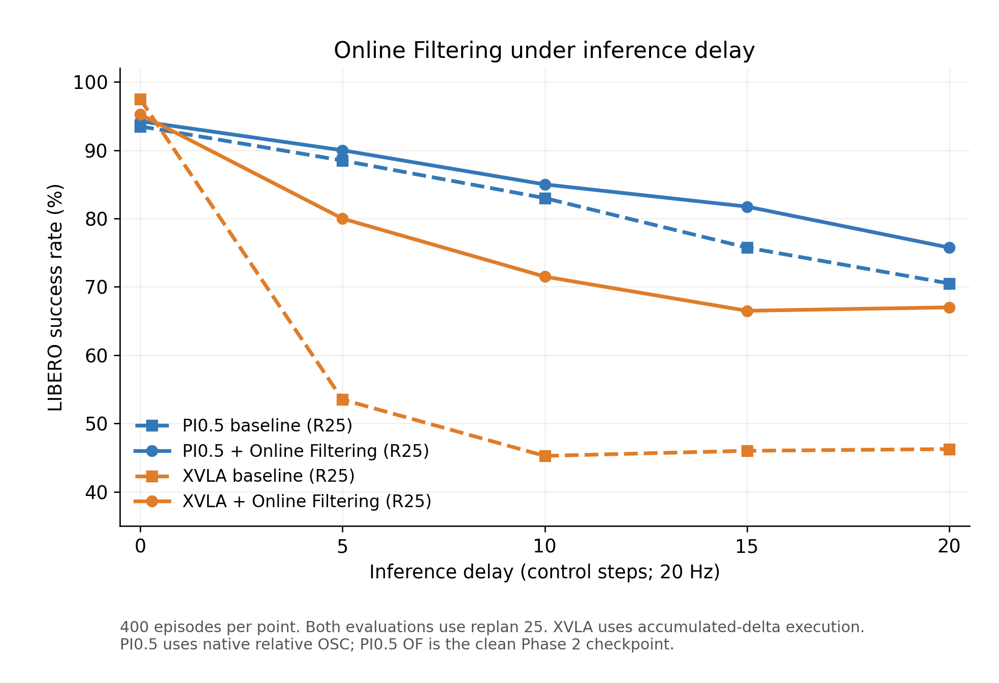

# Online Filtering：论文准备总稿

更新：2026-11-03。用途：作为论文动机、方法、实现、实验与讨论的事实底稿。数值的权威记录为 [metrics.md](metrics.md)，本文为写作需要引用其快照；后续更新应先更新 metrics。

## 1. 核心问题与论文叙事

VLA 通常基于某一时刻的视觉、语言和机器人状态生成一段动作。模型计算期间，机器人仍然运动，环境状态也随之变化。因此，新动作块可用时，其初始条件已经陈旧。单纯提高重规划频率无法消除一次推理内部的观测滞后；把整个大模型重新跑一遍则有额外计算成本。

本项目研究：**在一次动作生成尚未结束时，让后续去噪查询接收更近时刻的视觉与状态，持续修正尚未执行的动作后缀。** slow 分支保留任务理解和最初上下文，fast 分支提供随物理时间演进的观测。两者在同一个动作生成器中结合，而不是先得到完整动作再交给独立校正策略。

建议将论文问题拆成三问：

1. 观测到动作可用之间的延时，在给定执行协议下如何损害任务表现？
2. 在不重算完整 slow 上下文的情况下，生成过程能否利用新观测修正动作？
3. 该机制能否适配不同动作生成参数化的 backbone，并在一致的骨干内对照中改善成功率？

实验围绕PI0.5和XVLA两种backbone展开：PI0.5展示延时退化及在线更新的恢复效果，XVLA提供完整延时曲线，并进一步分析动作执行接口对延时敏感性的影响。

核心动机是：**观测陈旧在多任务操作中造成广泛性能损失，在线条件更新可以恢复其中一部分。**

## 2. 问题定义与因果时钟

设控制频率为 f，动作块长度为 H，计划重规划间隔为 R。触发时刻为 s，slow 条件为 C_s；一次生成期间经过 D 个控制步，物理延时为 τ=D/f。LIBERO 使用20 Hz，因此 delay0/5/10/15/20/25分别为0/250/500/750/1000/1250 ms。

生成期间机器人继续执行上一块动作。新块在 s+D 时刻可用后，从对应索引 D 开始使用，跳过已过期的前D项。单个完整推理在途时，实际触发间隔通常为max(R,D)，实验记录实际触发事件以核对时序。

当前 XVLA 完整实验取 H=50、R=25、D≤25，因此各档实际触发间隔都为25，且 H≥R+D。这样避免旧版 R=20 中 D25 实际触发周期变25的混杂。R+D≤H 是稳态覆盖等待期的预算条件，初始启动与具体队列策略仍应单独说明。

N=10次去噪查询采用合成控制时钟：

\[
d_k=\left\lfloor\frac{kD}{N-1}\right\rfloor,\qquad t_k=1-\frac{k}{N},\quad k=0,\ldots,N-1.
\]

在查询 k 前，将仿真推进到相应控制时刻，取得不晚于该时刻的观测。相邻查询的条件版本为 r=d_{max(k-1,0)} 和 d=d_k。两时刻不要求相差一个控制步；D小或没有新包时允许 old=new。

实验采用**受控合成推理延时**，以控制步数推进物理环境，研究观测陈旧与动作生成、执行时序之间的关系。

## 3. 当前方法：双时刻条件驱动的在线动作生成

### 3.1 slow / fast 分工

slow 分支在触发时刻编码原始任务上下文，保留 backbone 的语言、视觉和状态接口。在同一次生成内部复用其特征或 KV，不为每次 fast 更新重跑完整 slow VLM。

fast 分支接收一个时刻的多相机图像及同步 proprio。LIBERO 为外部和腕部两路相机。一个 packet 是“同一时刻的全部 fast 输入”，不是“一路相机”。当前主路径为：

```text
old images + old proprio → frozen DINOv3 + trainable resampler → F_old
new images + new proprio → frozen DINOv3 + trainable resampler → F_new
                                  ↓
             role embeddings + delay-pair embedding
                                  ↓
                residual cross-attention adapters
                                  ↓
                 更新当前动作 particle 的有效后缀
```

两相机合计64个视觉tokens，加1个proprio token，每时刻65 tokens；old/new拼接130 tokens。它们使用同一个 fast 编码分支，不是两个独立模型。可缓存已编码 packet；新时刻只需编码新包。

令 F_r、F_d 为两个时刻的 tokens，则条件形式为：

\[
e_{r,d}=\operatorname{MLP}([r,d,d-r]/D_{\max}),
\]
\[
C^{fast}_{r,d}=\operatorname{concat}(F_r+e_{old}+e_{r,d},\ F_d+e_{new}+e_{r,d}).
\]

PI0.5 的单包 fast 编码还带 delay；XVLA主要在pair层编码。old/new表示相邻查询前后的条件版本，不是始终以起点作为old，也不是固定的连续两帧滑窗。

### 3.2 注入方式与初始化

在若干 action transformer 层加入 residual cross-attention，仅更新动作tokens：

\[
h_a^{\ell+1}=h_{base}^{\ell+1}+W_o^{\ell}\operatorname{Attn}(Q(h_a),K(C^{fast}),V(C^{fast})).
\]

新增 cross-attention 的**输出投影零初始化**，使初始残差为零，起点接近原backbone行为；其余attention参数采用常规初始化。训练逐步学习fast条件对动作生成的修正。

当前默认插层：PI0.5为2/5/8/11/14/17，XVLA为3/7/11/15/19/23。当前统一路径没有显式 new−old innovation token、独立 posterior transport 网络或额外 learned residual gate。源码中保留旧类不代表本次实验使用这些机制。

### 3.3 前缀不可逆与后缀可修正

在物理时刻d，动作索引小于d的部分已执行，模型无权改写。实现包含三个不同约束：

- 查询前将 particle 的已执行前缀 hard commit；更新后保持该前缀。
- adapter 的 action-position mask 阻止新条件修改已执行位置。
- loss只覆盖有效且未padding的动作后缀；末尾padding观测通过有效性mask排除。

训练用专家数据前缀作为执行历史代理；部署使用实际已发送命令，并转换到与模型动作相同的坐标及归一化空间。

### 3.4 为什么需要两阶段

标准训练的插值 particle 来自固定数据终点与噪声，而部署时 particle 会经过多轮带变化条件的更新。新观测到来时，当前 particle 不一定仍处于单一固定条件的canonical路径上。Phase A 学习条件化动作生成并初始化新增模块；Phase 2 让模型接触先前在线更新产生的中间particle，学习从这些状态恢复动作后缀。

这里的“filtering”指沿生成过程吸收因果新观测、更新动作估计。

## 4. 训练目标

### 4.1 Phase A：canonical 初始化

采样一条示范内的动作块 A、总delay D与查询索引k。slow取块起点，fast取同轨迹的r/d时刻。噪声z与flow时间t构成：

\[
x_t=t z+(1-t)A.
\]

已执行前缀直接替换成A的对应部分。目标始终为同一块示范动作，不是按fast观测重新定义一条独立目标轨迹。

| Backbone | 输出参数化 | 监督 |
|---|---|---|
| PI0.5 | velocity v | 有效后缀上的 v 对 z−A 的MSE，限制真实动作维 |
| XVLA | endpoint  | 原生position / rotation6D / gripper损失，仅有效后缀 |

slow visual dropout 用于缓解完全依赖旧视觉而忽略fast的捷径。修复版XVLA在**多模态融合前**遮掉slow视觉特征及相应mask，避免图像信息先进入语言tokens后残留。Phase A从概率0开始，step500后在2000步内升到0.25。

dropout削弱slow-only捷径，为fast条件提供更直接的学习信号。

### 4.2 Phase 2 / Stage B：EMA rollout recovery

从Phase A初始化student，建立EMA teacher，衰减0.999。teacher仅产生中间particle；监督终点仍为示范动作A，不是teacher自己预测的终点。

1. 从噪声开始，按相同控制时钟切换old/new条件。
2. teacher rollout若干查询，每次预测前与更新后都commit当时前缀。
3. 取stop-gradient的rollout particle，student在对应新条件下预测恢复目标。
4. 只优化recovery目标，不额外混canonical loss。

PI0.5当前实现rollout长度1–4，Euler更新为 x←x−v/N，recovery velocity target为(x−A)/t。

XVLA当前实现rollout长度1–9，teacher采用endpoint重构：

\[
x_{k+1}=t_{k+1}z+(1-t_{k+1})\hat A_k,
\]

student继续监督endpoint A。不同rollout长度的样本停止后，保留自己的particle，不随其他样本继续推进或泄漏后续前缀。

修复版XVLA Stage B前6000步保持slow dropout0.25，再用18000步退火到0。训练DINOv3保持固定，resampler、adapter及配置允许的backbone参数参与训练；完整超参数保存在checkpoint配置中。

### 4.3 数据构造与扩展

EMA rollout扩展**模型生成过程的particle分布**，训练输入来自同一条示范轨迹，保持场景布局与任务进程一致。后续可进一步研究同轨迹邻域虚拟起点与chunk相位不对齐采样。

训练直接使用离线示范，便于沿用相同的数据构造方式扩展到真机。

## 5. PI0.5 与 XVLA 的实现映射

| 项目 | PI0.5当前clean实现 | XVLA当前实现 |
|---|---|---|
| Phase A入口 | training_stage=online_flow, online_flow_phase=canonical | training_stage=stage_a |
| Phase 2入口 | training_stage=online_flow, online_flow_phase=ema_rollout | training_stage=stage_b |
| slow主体 | prefix/KV与action expert | Florence特征与action transformer |
| 输出 | flow velocity | action endpoint |
| fast输入 | old/new多相机与proprio | old/new多相机与proprio |
| 结果对应训练链路 | no-innovation/annealed Phase 2 | 修复dropout后的Phase A / Phase B |

两个backbone使用不同配置字段实现相同的canonical初始化与rollout recovery阶段，具体入口见上表。

关键代码：

- PI0.5训练/推理：`src/lerobot/policies/online_filtering_pi05/modeling_online_filtering_pi05.py`。
- fast模块与runtime：`src/lerobot/policies/pi05/online_filtering.py`。
- XVLA训练/推理：`src/lerobot/policies/online_filtering_xvla/modeling_online_filtering_xvla.py`。
- 控制变换：`src/lerobot/policies/xvla/utils.py`。
- 连续延时评测：`research/scripts/eval_libero_synthetic_delay.py`。
- 本轮全量调度：`research/scripts/run_xvla_accumulated_full_eval.py`。

XVLA最终基线为真实H50训练30k，不是官方H30只在推理时扩展。baseline之后，修复版Phase A累计30k、Phase B30k，每卡batch32、global64，每10k保存。最终使用的Phase A权重为030000。

数据使用 `libero_lerobot_xvla_controller_v2_masked`：离线完整episode重建20D控制目标、body到grip-site旋转修正、腕部图像方向处理，并mask 894条无法恢复初始控制目标的记录。LeRobot metadata记录10fps，评测物理控制采用20Hz，两者分别记录数据元信息与控制时钟。详细数据核对见 [数据审计](xvla_data_audit_20261030.md)。

## 6. 执行接口是实验定义的一部分

### 6.1 原绝对目标协议

原XVLA预测绝对控制目标，底层OSC在MuJoCo物理动力学中追踪目标。它不使机器人瞬移；但即使切换时状态偏离，新块的绝对目标仍提供原全局轨迹的空间锚点，可能较快纠正偏差。因此它与增量轨迹协议对延时的敏感性可以明显不同。

实验通过对照绝对目标与增量轨迹接口，分析空间锚点及反馈追踪对延时损害的影响。

### 6.2 当前累计delta协议

为了研究切换时保留执行偏差的增量轨迹接口，当前完整实验采用独立协议：

1. 对生成的绝对目标 G_i 预计算相邻增量；首项相对触发观测pose，后续相对前一预测目标。
2. 推理期间旧块继续执行，新块过期前缀delta[:D]丢弃，不虚拟积分。
3. 首次实际执行delta[D]时，以**当时实测pose**初始化一次累计目标B。
4. 后续在同一chunk内累计增量，不每步用实测pose重置，也不恢复原G的全局位置。
5. 新chunk实际安装时才允许初始化其自己的B。gripper保留原开合命令，不差分。

在当前LIBERO坐标与裁剪约定下：

\[
\Delta p_i=(p_i-p_{i-1})/0.05,\qquad
\Delta\omega_i=\operatorname{Log}(R_iR_{i-1}^{\top})/0.5,
\]
\[
B_p\leftarrow B_p+0.05\operatorname{clip}(\Delta p_i),\qquad
B_R\leftarrow\operatorname{Exp}(0.5\operatorname{clip}(\Delta\omega_i))B_R.
\]

底层OSC接收累计后的绝对B，仅负责跟踪这一偏移后的轨迹。高层是累计增量语义，底层tracker仍是absolute模式；两者并不矛盾。OF前缀历史记录实际发送的B，而非未执行的原G。

CLI为 `--xvla-precomputed-deltas --xvla-delta-execution accumulated`。这与每步实测pose-relative直接下发delta、或每步反算到原绝对目标的接口不同。PI0.5采用原生相对动作训练，XVLA在执行侧将预测目标转换为累计增量轨迹。

### 6.3 执行器验证

- 恒定10mm目标实验：原absolute与累计目标执行的实际位移均约10.44mm；把相邻目标差分直接交给current-pose-relative OSC只走约2.03mm。后者会取消尚未完成的运动，已停用。
- 实模型trace验证base只在chunk切换重置，D15时切入索引15，未补执行前缀；位置累计误差约1.9e−9m。
- 零延时完整基线成功率97.50%。

这些执行接口试验构成评测设计与实现验证。完整定义与trace见 [协议](xvla_delayed_delta_protocol_20261103.md) 和 [控制器审计](xvla_delta_executor_audit_20261103.md)。

## 7. 阶段性实验与结论

### 7.1 PI0.5阶段性结果

20Hz、R20，每个固定delay模型400回合：

| Delay | ms | Official baseline | Phase A | Phase 2 |
|---:|---:|---:|---:|---:|
| 1 | 50 | 96.00% | 95.50% | 97.50% |
| 5 | 250 | 90.25% | 90.50% | 92.50% |
| 10 | 500 | 81.50% | 82.25% | 87.00% |
| 15 | 750 | 72.75% | — | — |
| 20 | 1000 | 68.25% | — | — |
| 25 | 1250 | 61.25% | — | — |

支持：baseline随这些延时档明显退化；Phase 2在1/5/10分别改善1.50/2.25/5.50个百分点，delay10优于Phase A 4.75个百分点。

动态delay1–10、每模型2000回合：Phase A30k为91.70%；mixed Phase2 30k为89.80%；no-innovation annealed Phase2 30k/60k为91.95%/92.05%。mixed方案下降；annealed相对Phase A改善0.25/0.35个百分点。固定delay用于观察延时响应曲线，动态delay用于评估变化时延下的总体表现。

### 7.2 XVLA早期绝对目标实验

真实H50基线与各阶段均使用20Hz、R20、每点400回合；各模型内执行协议一致：

| Delay | Baseline | 旧Phase A | 旧Phase B | 修复dropout Phase B |
|---:|---:|---:|---:|---:|
| 15 | 94.25% | 92.75% | 92.25% | 94.50% |
| 20 | 90.25% | 88.25% | 89.50% | 91.25% |
| 25 | 89.50% | 88.75% | 90.50% | 90.00% |

结论：原绝对目标协议下，旧训练没有稳定优势；修复后相对baseline改善0.25/1.00/0.50个百分点，幅度较小。该结果与R25累计delta实验分别报告，展示执行接口带来的差异。

### 7.3 从实现审计学到的内容

旧XVLA slow dropout位于多模态融合之后，图像信息已进入上下文语言tokens，造成视觉信息泄漏。修复前模型对fast图像扰动的输出变化可低至约1e−6，说明训练可能绕过fast条件。修复将mask移到融合前，相关计算路径和单元检查通过。

修复版Phase A10k同8片段探针：query9正确fast loss0.0175141，打乱图像0.0189449，输出变化RMS0.0264；旧版输出变化约1.7e−6。但重复起点观测loss没有变坏，因此“使用图像”与“利用观测新鲜度”必须分开。

修复版Phase B30k的canonical粒子探针：

| Query | 正常fast | 关闭adapter | 打乱fast图像 | 重复起点图像/状态 |
|---:|---:|---:|---:|---:|
| 0 | 0.0037689 | 0.0058841 | 0.0044752 | 0.0037689 |
| 5 | 0.0034931 | 0.0046463 | 0.0040600 | 0.0029853 |
| 9 | 0.0037586 | 0.0051821 | 0.0036931 | 0.0030707 |

三个query关闭adapter均增加误差，支持fast分支有作用；但打乱图像与重复起点条件并非始终更差。该探针使用8个片段，补充闭环实验中的fast分支依赖性分析。

另外修复了XVLA无callback时绕过fast的标准API路径，以及PI0.5 teacher预测前commit新增前缀的问题。XVLA正式评测使用带callback的在线路径。具体证据见 [实现审计](xvla_implementation_audit_20261101.md)。

### 7.4 XVLA当前完整实验：累计delta、R25

Baseline为真实H50 final30k；OF为修复dropout后的Phase B final30k。4 suites共40 tasks，每task10初始状态，每模型每delay400回合；完整六档共4800回合。20Hz，suite步数上限Spatial/Object/Goal/LIBERO-10分别280/280/300/520，paired per-task/episode seed1000。OF在每query直接编码当前simulator观测，不用异步buffer模拟可控sim时序。全部回合无队列断供。

| Delay | ms | Baseline | OF | 提升（百分点） |
|---:|---:|---:|---:|---:|
| 0 | 0 | 390/400，97.50% | 381/400，95.25% | −2.25 |
| 5 | 250 | 214/400，53.50% | 320/400，80.00% | +26.50 |
| 10 | 500 | 181/400，45.25% | 286/400，71.50% | +26.25 |
| 15 | 750 | 184/400，46.00% | 266/400，66.50% | +20.50 |
| 20 | 1000 | 185/400，46.25% | 268/400，67.00% | +20.75 |
| 25 | 1250 | 185/400，46.25% | 295/400，73.75% | +27.50 |

0–20五档中，每个非零延时OF都明显高于baseline，零延时低2.25个百分点。当前图按需求暂不画delay25，但原始结果与文档保留该档。

逐任务检查，每个任务每模型每delay只有10回合：

| Delay | Baseline相对自身D0：下降/相同/上升的任务数 | OF相对同delay baseline：提高/相同/下降的任务数 |
|---:|---:|---:|
| 5 | 36 / 2 / 2 | 30 / 7 / 3 |
| 10 | 36 / 2 / 2 | 27 / 8 / 5 |
| 15 | 33 / 5 / 2 | 26 / 8 / 6 |
| 20 | 35 / 4 / 1 | 29 / 7 / 4 |
| 25 | 35 / 3 / 2 | 30 / 7 / 3 |

逐任务结果显示延时损害广泛存在，OF在多数任务上改善成功率。

D10–25 baseline接近平台，OF在D25回升。本轮R25固定，回升的进一步分析将围绕观测时间、动作阶段、跳过的前缀、旧块覆盖和任务分布展开。

结果来源：`research/outputs/xvla_accumulated_full_r25_20261103/comparison.json`。四suite详细表见metrics。全部4800回合完成；中途资源错误保留已完成前缀续跑，不将OOM中断计为策略失败。



图中PI0.5最早点为D1，OF只有D1/5/10；图中分别展示两种backbone的baseline/OF延时响应。

## 8. 阶段性结论

1. **观测陈旧带来广泛的任务性能损失。** PI0.5与XVLA实验均展示延时下的明显退化，XVLA逐任务结果显示这一影响覆盖多数任务。
2. **在线生成条件更新提高延时鲁棒性。** XVLA累计delta协议下非零延时提升20.50–27.50个百分点；PI0.5在固定delay1/5/10分别提升1.50/2.25/5.50个百分点。
3. **两阶段训练将条件学习与在线生成恢复衔接起来。** Phase A建立canonical生成能力，Phase 2在变化条件产生的中间particle上训练recovery；PI0.5固定delay10时Phase 2较Phase A提升4.75个百分点。
4. **slow视觉依赖和执行参考共同影响收益。** 融合前dropout改善fast条件学习；absolute与累计delta接口的对照揭示延时敏感性与控制参考的联系。
5. **生成时条件更新是一条可扩展的路径。** velocity与endpoint两类参数化均有对应实现，统一使用双时刻条件、前缀约束及rollout recovery。

## 9. 后续实验计划

### 9.1 方法消融

在当前R25累计delta协议下，比较正常在线观测、每query重复触发时刻观测、关闭adapter；补充修复Phase A同协议结果。分别分析观测新鲜度、fast分支和rollout recovery的贡献。

### 9.2 执行接口分析

保留absolute与累计delta结果，比较两种接口的延时响应；结合执行trace分析切换参考、旋转组合、clipping和低层tracking。对已记录的Spatial task5/init0零延时轨迹差异继续定位，以丰富接口分析。

### 9.3 统一跨骨干评测

补齐PI0.5双时刻实现的D0/5/10/15/20与Phase A/Phase2对照，统一记录R、H、动作语义与训练预算。

### 9.4 统计与泛化

针对40任务×10状态的层次结构，报告suite与任务分布、配对差异、考虑任务聚类的bootstrap区间和多seed结果。

### 9.5 效率和真实部署

测量slow编码、fast编码、每query adapter、整体生成时间、显存、参数量及packet更新率，在相同硬件下与重算完整模型对照。真机采用timestamp/latest-ready和真实执行计数，评估异步更新、延时抖动及闭环任务表现。

## 10. 建议论文结构与贡献措辞

- Introduction：观测在生成期间陈旧；重规划只更新块间条件；提出生成过程中吸收新观测。
- Method：因果控制时钟 → 双时刻fast条件 → action adapters与前缀约束 → canonical / EMA rollout两阶段。
- Implementation：PI0.5 velocity与XVLA endpoint的统一接口，以及不同执行语义。
- Experiments：按版本和协议分表；主表延时曲线，辅表absolute接口、阶段和观测消融、效率与真机。
- Discussion：数据前缀代理、particle recovery与物理恢复的差别、非单调性、协议敏感性及适用范围。

可作为引言贡献草稿：

> 我们研究动作块生成过程中的观测陈旧问题，提出利用轻量视觉与状态分支持续更新生成条件的Online Filtering框架。该框架通过双时刻条件和残差cross-attention修正尚未执行的动作，并通过canonical初始化与EMA rollout recovery适配变化条件下的中间生成状态。我们在LIBERO中系统分析推理延时与执行接口的交互，并在XVLA累计增量执行实验中观察到显著的延时鲁棒性改善。

后续随消融、统一跨骨干评测及真机实验的完成，更新摘要与贡献中的实验范围。

## 11. 产物与复现索引

- 权威指标：[metrics.md](metrics.md)。
- 方法/阶段字段：[当前实现说明](online_filtering_current_method_20261101.md)。其中早期训练状态段落属于历史快照，最新已完成结果以metrics及本文为准。
- 数据：[XVLA数据审计](xvla_data_audit_20261030.md)。
- 实现问题与fast依赖性：[实现审计](xvla_implementation_audit_20261101.md)。
- 控制：[累计delta协议](xvla_delayed_delta_protocol_20261103.md)、[执行器审计](xvla_delta_executor_audit_20261103.md)。
- 当前全量实验：[R25实验记录](xvla_accumulated_full_r25_20261103.md)。
- baseline checkpoint：`/data/yhr/output/online_filtering/ckpt/xvla50_corrected_v2_2gpu_b32_30k_20261031/checkpoints/030000/pretrained_model`。
- 修复Phase A最终权重：`/data/yhr/output/online_filtering/ckpt/xvla50_phase_a_dropoutfix_2gpu_b32_10k_20261101/checkpoints/030000/pretrained_model`。
- 修复Phase B最终权重：`/data/yhr/output/online_filtering/ckpt/xvla50_phase_b_dropoutfix_2gpu_b32_30k_20261102/checkpoints/030000/pretrained_model`。
- PI0.5固定delay原始结果（no-innovation/annealed Phase 2 30k）：`/data/yhr/output/online_filtering/eval/fixed_delay_sweep_fps20/`。
- 当前完整结果：`research/outputs/xvla_accumulated_full_r25_20261103/comparison.json`。
- 图表和可编辑数据：`research/figures/libero_delay_0_20.{png,pdf,svg,csv}`；重绘脚本 `research/figures/plot_delay_curves.py`。

相关工作写作可围绕flow matching、在线/异步VLA、action chunking和延时补偿四条线组织。
